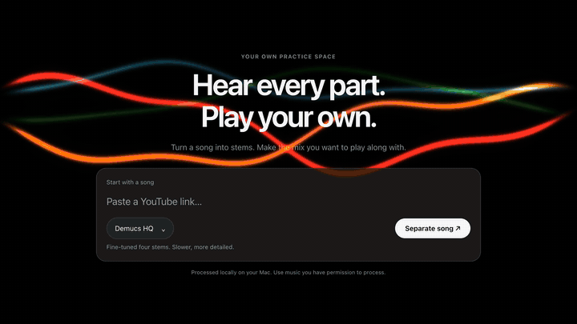

# OpenMoises

A local, open-source practice app for musicians. Paste a YouTube link and OpenMoises splits the song into stems (drums, bass, vocals, other, and optionally guitar and piano) on your own machine. Then play along in the browser with per-stem volume, mute and solo, live tempo and key changes, A-B looping, and detected key and BPM. Setlists remember the tempo, key, mix and loop you practise each song with. There are no monthly limits because nothing leaves your computer.



*[Watch with sound (MP4)](docs/demo.mp4)*

## Requirements

- [uv](https://docs.astral.sh/uv/) and ffmpeg. uv installs Python 3.11 and the exact dependencies from `uv.lock`.
- Tested only on Apple Silicon Macs. The lockfile also resolves for Linux and Windows, where separation runs on the CPU and is slower. Intel Macs aren't supported because Demucs pins an old torch there.
- About 450 MB of disk for all three Demucs models, plus roughly 40 MB per minute of audio per song (4 stems).

## Setup

```bash
brew install ffmpeg uv
uv run backend/server.py
```

The first `uv run` creates `.venv` and installs everything. Open http://localhost:8000. The first separation downloads the Demucs model.

With [just](https://github.com/casey/just) installed (`brew install just`), you can run the server in the background instead:

```bash
just start   # uv sync, then start the server on :8000 (logs in .run/server.log)
just stop    # stop the server started by just start
```

## Project layout

```
backend/
  server.py     HTTP server: song library API, YouTube download, Demucs separation, static files
  analyze.py    key and BPM detection from the stems (runs as a subprocess)
web/
  index.html    markup
  style.css
  app.js        audio engine, library, routing, views
  home-bg.js    animated WebGL background on the home screen
  vendor/       Signalsmith Stretch (real-time tempo and pitch), three.js
tests/
  ui.cjs                 browser test of routes, Studio, layout, playback (mocked audio)
  studio-animation.cjs   Studio open and close transitions
  playlists.cjs          setlists: sidebar limits, save from Studio, play with saved settings, reorder, delete
  realtime.cjs           real stems stay in sync and keep up in real time (needs a song in the library)
songs/          your library, one folder per song, plus playlists.json (not committed)
pyproject.toml  Python dependencies; uv.lock pins exact versions
justfile        just start / just stop for a background server
```

## Separation models

| Option | Demucs model | Stems | Time for a 4.5 minute song on an M-series Mac |
|---|---|---|---|
| Fast | `htdemucs` | 4 | about 25 s |
| HQ (default) | `htdemucs_ft` | 4, cleaner | about 1.5 min |
| 6 stems | `htdemucs_6s` | adds guitar and piano | about 25 s |

## Tests

```bash
npm install
npx playwright install chromium
uv run backend/server.py &             # the tests load the app from localhost:8000
npm test
npm run test:realtime                  # optional, uses a real song from your library
uv run backend/analyze.py              # key and BPM self-check
```

## Credits

- [Demucs](https://github.com/facebookresearch/demucs) (MIT) separates the stems.
- [Signalsmith Stretch](https://signalsmith-audio.co.uk/code/stretch/) (MIT) changes tempo and pitch in real time.
- [yt-dlp](https://github.com/yt-dlp/yt-dlp) (Unlicense) downloads the audio.
- [librosa](https://librosa.org/) (ISC) detects key and tempo.
- [three.js](https://threejs.org/) (MIT) draws the home screen background.

## Use responsibly

OpenMoises is for personal practice. Only process music you have the right to use, and respect YouTube's Terms of Service.

## License

[MIT](LICENSE) © 2026 Pirayan Rananand
